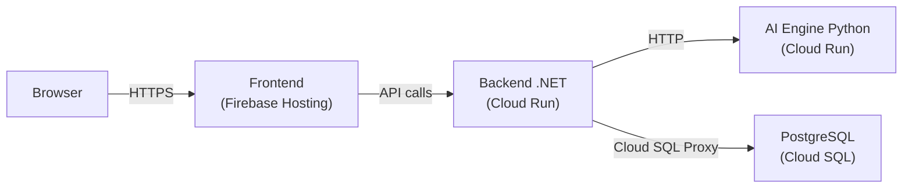

# MorfoLog — GCP Deployment Guide

## Architecture Overview



| Component | Hosting | Script |
|-----------|---------|--------|
| AI Engine (Python) | Cloud Run (`morfolog-ai`) | `deploy_ai.ps1` |
| Backend (.NET) | Cloud Run (`morfolog-backend`) | `deploy_backend.ps1` |
| Frontend (React) | Firebase Hosting | `deploy_frontend.ps1` |

**GCP Project:** `gen-lang-client-0852605338`  
**Region:** `europe-central2`  
**Artifact Registry repo:** `morfolog`

---

## Deployment Order (important!)

Deploy in this exact order because each layer depends on the URL or configuration of the previous one:

### 1. AI Engine — `deploy_ai.ps1`

Both scripts support the `-Build` flag to automatically build the Docker image in Google Cloud Build before deploying.

```powershell
# When you modified Python code (builds in Cloud Build + deploys):
.\deploy_ai.ps1 -Build

# When you just want to re-deploy or update configuration without rebuilding:
.\deploy_ai.ps1

# Optional: specify a custom tag (defaults to "test4"):
.\deploy_ai.ps1 -Build -Tag v2
```

- Deploys to Cloud Run, port 8080, 512 Mi RAM, 300s timeout.
- Publicly accessible (`--allow-unauthenticated`).
- Produces a URL like `https://morfolog-ai-<hash>-lm.a.run.app`.

### 2. Backend — `deploy_backend.ps1`

```powershell
# When you modified .NET backend code (builds in Cloud Build + deploys):
.\deploy_backend.ps1 -Build

# When you just want to update configuration or re-deploy:
.\deploy_backend.ps1

# Optional: specify a custom tag (defaults to "test-dotnet2"):
.\deploy_backend.ps1 -Build -Tag v2
```

- **Auto-detects** the AI Engine URL via `gcloud run services describe morfolog-ai` and injects it as `AiServiceUrl` env var.
- Connects to Cloud SQL instance `morfolog-db-prod` via Cloud SQL proxy; DB connection string comes from Secret Manager (`DB_CONNECTION_STRING`).
- Produces a URL like `https://morfolog-backend-<hash>-lm.a.run.app`.

### 3. Frontend — `deploy_frontend.ps1`

```powershell
.\deploy_frontend.ps1
```

- Reads backend URL from `frontend-react/.env.production` (must exist before build).
- Runs `npm install && npm run build`, then `firebase deploy --only hosting`.
- After deploy, **prompts you** to paste the Firebase Hosting URL, then updates the backend's `AllowedCorsOrigins__0` env var so the backend allows CORS from the frontend.

---

## ⚠️ The URL / CORS Problem (no custom domain)

> [!CAUTION]
> Because you don't have a custom domain, **service URLs and Firebase URLs can change**, which breaks the links between components.

### What happens

1. **You redeploy the backend** → Cloud Run URL could change if service name or region changes.
2. **The frontend is built with the OLD backend URL** baked into `.env.production` → API calls from the browser start failing (404 / network error).
3. **You redeploy the frontend** to fix it → Firebase gives a Hosting URL.
4. **The backend's CORS allowlist still has the OLD frontend URL** → browser requests are blocked by CORS.

### How to avoid it

| Rule | How |
|------|-----|
| **Do not delete & recreate Cloud Run services** | Cloud Run keeps the same URL as long as the **service name** and **region** don't change. Pushing new revisions (via `-Build` or updating images) **preserves the URL**. |
| **Always check `frontend-react\.env.production`** | Ensure the backend URL matches the actual `morfolog-backend` URL before running `deploy_frontend.ps1`. |
| **Complete the CORS prompt in `deploy_frontend.ps1`** | When prompted at the end of the script, paste the Firebase Hosting URL so backend CORS is updated automatically. |
| **Best long-term fix: Custom domain** | Map domains to Cloud Run (`api.yourdomain.com`) and Firebase (`app.yourdomain.com`) so URLs never change. |

### Quick check commands

```powershell
# Get current AI service URL
gcloud run services describe morfolog-ai --region europe-central2 --format="value(status.url)"

# Get current Backend URL
gcloud run services describe morfolog-backend --region europe-central2 --format="value(status.url)"

# Check what CORS origin the backend currently allows
gcloud run services describe morfolog-backend --region europe-central2 --format="value(spec.template.spec.containers[0].env)"

# Manually fix CORS on backend if needed
gcloud run services update morfolog-backend --region europe-central2 --update-env-vars "AllowedCorsOrigins__0=https://your-frontend-url.web.app"
```

---

## TL;DR Cheat Sheet

```powershell
# 1. AI Engine (build + deploy)
.\deploy_ai.ps1 -Build

# 2. Backend (build + deploy, auto-reads AI URL)
.\deploy_backend.ps1 -Build

# 3. Check frontend-react\.env.production has the backend URL, then:
.\deploy_frontend.ps1
# (Paste Firebase URL when prompted to auto-update backend CORS)
```
